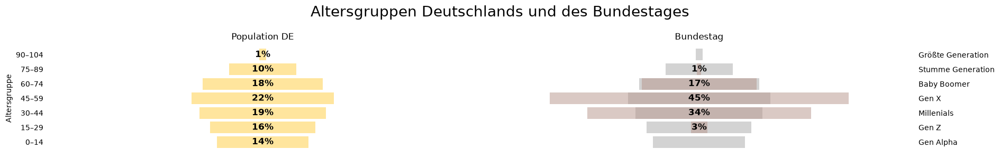
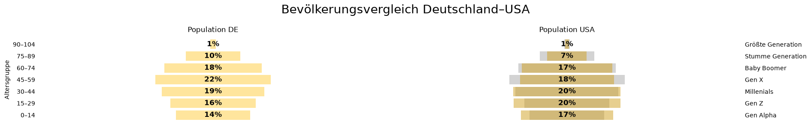
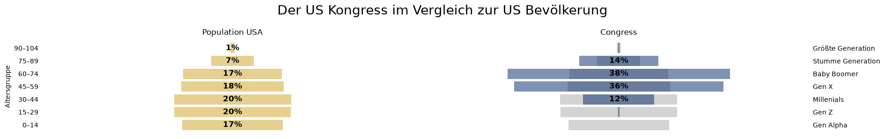
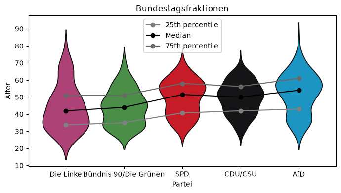
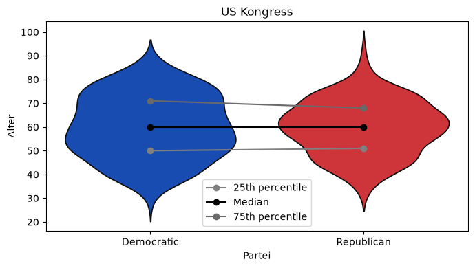

# Amerika ist jünger als Deutschland, seine Volksvertreter sind älter

*Altersstruktur des US Kongresses vor den Zwischenwahlen 2026*

    Oktober 2026

**Die amerikanische Bevölkerung ist jünger als die deutsche. Der derzeitige amerikanische Kongress hingegen ist etwa zehn Jahre älter als der deutsche Bundestag und die beiden vertretenen Parteien – Demokraten und Republikaner – unterscheiden sich kaum in ihrer Altersstruktur.**

> ["Generation X macht Deutschlands Politik"](https://github.com/nikomin/Gen-X-im-Deutschen-Bundestag/blob/main/Gen%20X%20macht%20die%20Politik.ipynb). So schloss ich im Juni 2025 aus einer kleinen Übung mit den Eigenangaben der Bundestagsabgeordneten und den Daten zu Deutschlands Bevölkerung. Die sogenannte Generation X ist unter den Abgeordneten doppelt so häufig vertreten (45%) wie in der gesamten Bevölkerung (22%). Außerdem zeigt die Aufschlüsselung nach Parteien: je weiter "rechts" Parteien typischerweise  eingeordnet werden, desto älter sind auch deren Fraktionen.

## Einleitung

Zur Einfachheit hatte ich den Bundestag und die Gesamtbevölkerung in sogenannten Generationen zusammengefasst. Durchgesetzt haben sich Bezeichnungen wie Millenials oder Baby Boomer für jeweils fünfzehn Jahrgänge, deren gemeinsame Prägung eine zeitbezogene Ähnlichkeit aufweisen sollen.

Nach dieser Einteilung gehören 22 Prozent der deutschen Bevölkerung zur Generation X ([Daten vom Statistischen Bundesamt](https://service.destatis.de/bevoelkerungspyramide/index.html)), im Bundestag ist diese Gruppe aber mit 45 Prozent vertreten (diese Daten kommen von [bundestag.de/abgeordnete](https://www.bundestag.de/abgeordnete)). Hier nochmal die Grafiken im Vergleich:


```python
from definitions_ageGroupsUS import *
from demographyCode_v2 import *
```


```python
plotRowOfHistogramComparisons("Population DE",["Population DE",'Bundestag'],histograms_bun,
                              popBins, colors, "Altersgruppen Deutschlands und des Bundestages")
```


    

    


**Der Altersmedian des Bundestages liegt bei 50 Jahren, eine Hälfte der Abgeordneten ist also älter und die andere Hälfte jünger als fünfzig.**

## Amerika ist jünger

Im Vergleich der Bevölkerungen Deutschlands und der USA sieht man, dass die USA insgesamt jünger sind. Die drei jüngsten Altersgruppen (Alpha, Z und Millenials) machen in den USA 57 Prozent aus, in Deutschland nur 49 Prozent.

Die sogenannten Baby Boomer, zwischen 60 und 74 Jahren alt, gibt es in beiden Ländern genauso häufig.


```python
plotRowOfHistogramComparisons("Population DE",["Population DE","Population USA"],histograms_con, 
                              popBins, colors, "Bevölkerungsvergleich Deutschland–USA")
```


    

    


## Der Kongress ist hingegen älter

Die größte Gruppe im amerikanischen Kongress ist die der Baby Boomer. Die nächst ältere Gruppe, die "Stumme Generation", die im Bundestag fast gar nicht vorkommt, macht im Kongress 14 Prozent aus. Alle drei Gruppen – Gen X, Boomer und die noch älterern – sind im Kongress doppelt so häufig wie in der amerikanischen Gesamtbevölkerung. **Die Häfte des Kongresses ist älter als 60 Jahre.** 


```python
plotRowOfHistogramComparisons("Population USA",["Population USA",'Congress'],histograms_con,  
                              popBins, colors, "Der US Kongress im Vergleich zur US Bevölkerung")
```


    

    


## Alter und Orientierung

In den Überlegungen vom Juni 2025 zeigte ich relativ allgemein, welche Generationen in den Fraktionen dominieren. Man sieht das noch viel deutlicher, wenn man die Parteien von "links" nach "rechts" sortiert und die sogenannten Quantile miteinander vergleicht, also das Alter, welches die Fraktionen in vier gleich große Gruppen teilt. Je weiter rechts die Partei steht, desto älter sind die Gruppen. SPD und CDU/CSU sind hier eine Ausnahme: die Werte ändern sich kaum. Die Sozialdemokraten sind etwas breiter aufgestellt als die Christen.


```python
violinplotsOfFractions(members_Bundestag, ['Die Linke', 'Bündnis 90/Die Grünen', 'SPD', 'CDU/CSU', 'AfD'], colors, 
                       "Bundestagsfraktionen",figsize=(7,4))
```


    

    


Ähnlich wie bei den klassischen deutschen Volksparteien unterscheiden sich die Fraktionen der amerikanischen Abgeordneten kaum. Die Demokraten sind, wie die Abgeordneten der SPD, "etwas breiter aufgestellt".


```python
violinplotsOfFractions(members_congress, ['Democratic','Republican'], colors, "US Kongress",figsize=(7,4))
```


    

    


## Herkunft der Daten
Die amerikanischen Bevölkerungsdaten sind vom [United States Census Bureau](https://www.census.gov/data/datasets/time-series/demo/popest/2020s-national-detail.html). Die Liste der amerikanischen Abgeordneten sind von den Wikipediaseiten 
- https://en.wikipedia.org/wiki/List_of_current_United_States_representatives und
- https://en.wikipedia.org/wiki/List_of_current_United_States_senators

am 7. Oktober 2026 eingesammelt worden. Die Auf- und Vorbereitung der Daten ist in den notebooks 01-dataPrep.ipynb und 02-analysis.ipynb.

*[CC BY-SA](https://creativecommons.org/licenses/by-sa/4.0/) Niko Komin, Oktober 2026*


```python

```
