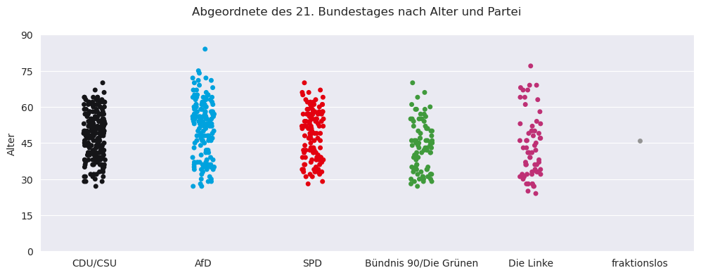
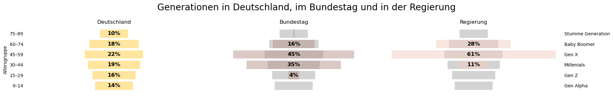
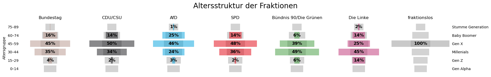

# Gen X macht Deutschlands Politik

*Juni 2025*

**Fast die Hälfte des 21. Deutschen Bundestages ist zwischen 45 und 60 Jahren alt, gehört also grob zur Generation X. Die Millenials bilden die zweitgrößte Gruppe. Bei den einzelnen Parteien gibt es Unterschiede: während die einen stärker auf ältere setzen, verlassen sich die anderen stärker auf jüngere.**

Der aktuelle Deutsche Bundestag wurde am 23. Februar 2025 gewählt und hatte am 25. März seine erste Sitzung. Die Internetseite des Bundestages [bundestag.de/abgeordnete](https://www.bundestag.de/abgeordnete) listet alle gegenwärtigen Abgeordneten mit Namen, Parteizugehörigkeit und einer vom Mitglied selbst erstellten Biographie. Diese Informationen haben wir im Mai abgerufen und die Mitglieder nach Alter und Parteizugehörigkeit sortiert.

Es gibt fünf Fraktionen im aktuellen Bundestag, ein Mitglied ist fraktionslos. Der/die jüngste Abgeordnete ist 24 Jahre alt und gehört zur Partei *Die Linke*. Das älteste Mitglied ist 84 Jahre alt und gehört der *AfD* an.


```python
from demographyCode import *
plotMembers()
```


    

    


    
    
    Die jeweils jüngsten und ältesten Mitglieder in jeder Fraktion sind:
    +-----+-----------+-------+-------+-------------------------+-------------+----------------+
    |     |   CDU/CSU |   AfD |   SPD |   Bündnis 90/Die Grünen |   Die Linke |   fraktionslos |
    |-----+-----------+-------+-------+-------------------------+-------------+----------------|
    | min |        27 |    27 |    28 |                      27 |          24 |             46 |
    | max |        70 |    84 |    70 |                      70 |          77 |             46 |
    +-----+-----------+-------+-------+-------------------------+-------------+----------------+


***Abbildung – Alter der Abgeordneten:*** *Jedes Mitglied ist durch einen Punkt dargestellt, die Farbe spiegelt die Partei, die Höhe das Alter. Bei den jeweiligen Fraktionen sind manche Altersgruppen stärker vertreten, die Punkte stehen dichter beieinander. Andere Gruppen sind kleiner, die Punkte also weiter auseinander.*
    

## Altersgruppen

Oft werden Personen über ihr Alter grob einer *Generation* zugeordnet (siehe [Wikipedia: Generation](https://de.wikipedia.org/wiki/Generation_%28Gesellschaft%29)). Diese Altersgruppen sollen gewisse Ähnlichkeiten aufweisen, da sich ihre historischen und kulturellen Umstände ähneln. Obwohl die persönlichen Erfahrungen international sehr unterschiedlich sein können, haben sich im Laufe der letzten Jahre universelle Bezeichnungen und Zeitspannen verbreitet. 

Wir werden hier der Einfachheit halber jeweils 15 Geburtsjahrgänge zusammenfassen. Dann besteht der Bundestag aus folgenden Generationen: Generation Z (15–29 Jahre alt), Millenials (30–44), Generation X (45–59), Baby Boomer (60–74) und die Stumme Generation (75–89). Die Jahrgänge der beiden letztgenannten Generationen werden in der Regel weiter gefasst, wir bleiben hier bei 15 Jahrgängen. Generation Alpha ist unter 15 Jahre alt, kommt also im Bundestag noch nicht vor. Etwa ein Prozent der Deutschen ist über 90, im Bundestag sitzt niemand in diesem Alter.

Generation X ist die größte Gruppe in der Gesamtbevölkerung, aber nur mit einem kleinen Vorsprung. JedeR fünfte Deutsche gehört zu dieser Gruppe. Im Bundestag ist ihr Anteil jedoch mit 45 Prozent doppelt so groß, Gen X ist überproportional vertreten. Die Alterspyramiden in der nächsten Grafik zeigen die Unterschiede.


```python
plotGenerations_DEvsBTvsRegierung()
```


    

    


***Abbildung – Generationen in Deutschland, im Bundestag und in der Regierung:*** *Alterspyramiden zeigen, dass in Deutschland etwas mehr als ein Fünftel zur Gen X gehört. Im Bundestages ist es fast die Häfte, in der Regierung sind es fast zwei Drittel. Jeweils 15 Jahrgänge sind in einer Generation zusammengefasst.*

## Die Fraktionen

Die Altersstruktur der Fraktionen von *CDU/CSU* und *SPD* sind nahezu gleich: fast 50 Prozent gehören zur Gen X, die zweitgrößte Gruppe stellen die Millenials mit 34 Prozent. Baby Boomer gibt es schon viel weniger (14 Prozent) und Gen Z ist kaum vorhanden. 

Bei der *AfD*-Fraktion, die den ältesten Abgeordneten stellt, ist auch fast Hälfte aus der Gen X. Die zweitgrößte Gruppe ist hier aber nicht jünger sondern älter, ein Viertel der Abgeordneten dieser Fraktion sind Baby Boomer.

Ganz anders bei *Bündnis 90/Die Grünen* und *Die Linke*. Bei den Grünen dominieren die Millenials, auf Kosten von Gen X und Baby Boomer. Aber auch Abgeordnete der Gen Z sind anteilig viel häufiger als bei den drei stärksten Fraktionen. Bei der Linken stellen die Millenials auch die größte Gruppe, hier aber nur auf Kosten der Gen X. Baby Boomer sind hier so oft anzutreffen wie bei Schwarz und Rot. Dafür ist der Anteil der Gen Z so hoch wie bei keiner anderen Fraktion.


```python
plotGenerations_BTvsParties()
```


    

    


***Abbildung – Die Fraktionen im Vergleich:*** *CDU/CSU, SPD und AfD werden von Gen X dominiert. Bei den Grünen und der Linken dominieren die Millenials, zusammen mit Gen Z.*

---

Code und Jupyter Notebook stehen [hier zum Download](https://github.com/nikomin/Gen-X-im-Deutschen-Bundestag/blob/main/Gen%20X%20macht%20die%20Politik.ipynb) zur Verfügung.

*[CC BY-SA](https://creativecommons.org/licenses/by-sa/4.0/) Niko Komin, Juni 2025*
